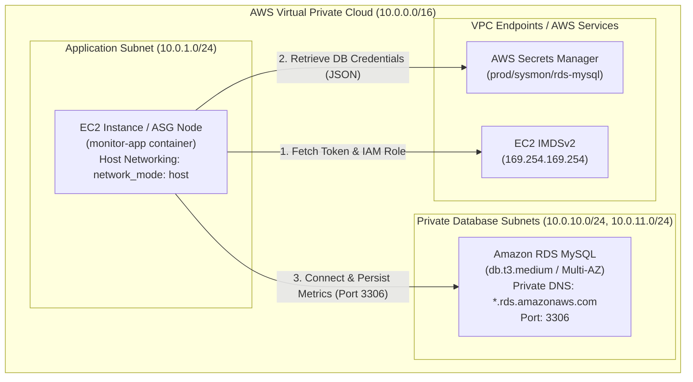
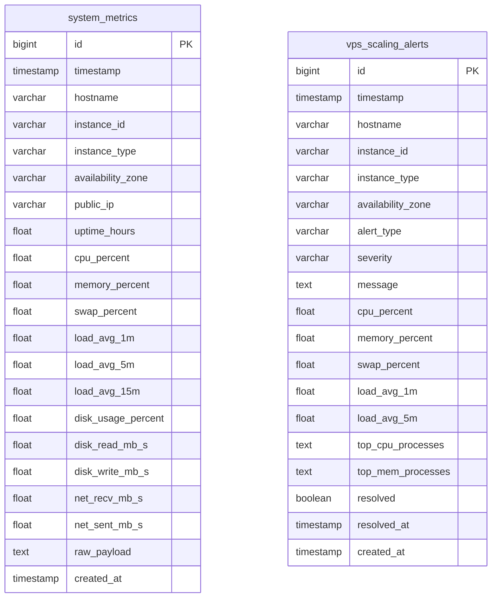

# AWS Secrets Manager & RDS MySQL Integration Guide

This guide details the production architecture, IAM permissions, security group configuration, and database schema for persisting system metrics and autoscaling alerts from `monitor-app` into an Amazon RDS MySQL database deployed in private subnets.

---

## 1. Production Architecture

In production, the database is never exposed to the public internet. It resides in private database subnets across multiple availability zones. `monitor-app` runs on EC2 instances inside application subnets and securely authenticates with zero plaintext passwords by retrieving database credentials dynamically from **AWS Secrets Manager** via IAM instance roles.



### Security Group Ingress Chaining

Never allow `0.0.0.0/0` on port 3306. Instead, reference the EC2 Security Group ID directly:

| Security Group | Direction | Protocol | Port | Source / Destination | Purpose |
| :--- | :--- | :--- | :--- | :--- | :--- |
| **EC2 SG** (`sg-app-nodes`) | Egress | TCP | 3306 | `sg-rds-mysql` | Outbound DB traffic to RDS |
| **RDS SG** (`sg-rds-mysql`) | Ingress | TCP | 3306 | `sg-app-nodes` (Security Group reference) | Allows only authorized EC2 instances |

---

## 2. AWS Secrets Manager Setup

### Step 1: Store Credentials in Secrets Manager

In AWS Secrets Manager, create a secret with the name `prod/sysmon/rds-mysql`:

- **Secret type**: *Credentials for Amazon RDS database* (or *Other type of secret*).
- **Key/Value Pairs**:
  ```json
  {
    "host": "sysmon-rds.c1234567890.us-east-1.rds.amazonaws.com",
    "port": 3306,
    "username": "sysmon_admin",
    "password": "<STRONG_GENERATED_PASSWORD>",
    "dbname": "sysmon_db"
  }
  ```

### Step 2: IAM Instance Profile Policy

Attach the following policy to the IAM Role assigned to your EC2 instances:

```json
{
  "Version": "2012-10-17",
  "Statement": [
    {
      "Sid": "AllowSysmonSecretAccess",
      "Effect": "Allow",
      "Action": [
        "secretsmanager:GetSecretValue",
        "secretsmanager:DescribeSecret"
      ],
      "Resource": "arn:aws:secretsmanager:us-east-1:*:secret:prod/sysmon/rds-mysql-*"
    }
  ]
}
```

> [!NOTE]
> Because `monitor-app` runs with `network_mode: host`, the container can communicate directly with the local EC2 Instance Metadata Service (`http://169.254.169.254/latest/meta-data/`) to automatically acquire temporary AWS credentials without any static API keys.

---

## 3. Database Schema: Metrics & VPS Scaling Alerts

The application automatically creates and manages two dedicated tables upon startup:



### Table 1: `system_metrics` (Continuous Heartbeat Telemetry)
Stores continuous resource utilization samples (default: every 10 seconds).
- `timestamp`: Sampling time.
- `hostname`: Host OS name.
- `instance_id`: AWS EC2 instance identifier (e.g., `i-0123456789abcdef0`).
- `instance_type` & `availability_zone`: EC2 hardware profile & placement.
- `cpu_percent`, `memory_percent`, `swap_percent`: Immediate resource utilization.
- `load_avg_1m`, `load_avg_5m`, `load_avg_15m`: CPU load averages.
- `disk_read_mb_s`, `disk_write_mb_s`: Real-time disk I/O throughput.
- `net_recv_mb_s`, `net_sent_mb_s`: Real-time network throughput.
- `raw_payload`: Complete JSON telemetry snapshot.

### Table 2: `vps_scaling_alerts` (Spikes & Autoscaling Forensics)
Separated into a dedicated table for long-term autoscaling audits and web dashboard consumption:
- Triggered whenever an alert condition occurs (CPU > threshold, Memory > threshold, load spikes).
- Snapshots the **top resource-consuming processes** (`top_cpu_processes`, `top_mem_processes`) in structured JSON at the exact moment of the spike.
- Enables queries to understand *why* an instance spiked and *when* autoscaling scale-out events were provoked.

---

## 4. Useful SQL Queries for Dashboards & Audits

### Identify Recent High-Usage VPS Alert Events
```sql
SELECT 
    timestamp,
    hostname,
    instance_id,
    alert_type,
    severity,
    cpu_percent,
    memory_percent,
    load_avg_1m,
    message
FROM vps_scaling_alerts
WHERE timestamp >= NOW() - INTERVAL 24 HOUR
ORDER BY timestamp DESC;
```

### Inspect Processes Causing the Spike
```sql
SELECT 
    id,
    timestamp,
    instance_id,
    alert_type,
    top_cpu_processes
FROM vps_scaling_alerts
WHERE severity = 'CRITICAL'
ORDER BY id DESC
LIMIT 5;
```

### Daily Average Utilization by EC2 Instance
```sql
SELECT 
    DATE(timestamp) AS metric_date,
    instance_id,
    ROUND(AVG(cpu_percent), 2) AS avg_cpu,
    ROUND(MAX(cpu_percent), 2) AS max_cpu,
    ROUND(AVG(memory_percent), 2) AS avg_mem,
    ROUND(MAX(memory_percent), 2) AS max_mem
FROM system_metrics
WHERE timestamp >= NOW() - INTERVAL 7 DAY
GROUP BY DATE(timestamp), instance_id
ORDER BY metric_date DESC;
```

---

## 5. Non-Interactive EC2 Deployment via User Data

Paste this non-interactive block into your Terraform `user_data` or Cloud-Init script:

```bash
#!/bin/bash
set -euo pipefail
export DEBIAN_FRONTEND=noninteractive

# 1. Install Docker & Compose v2 unattended
curl -fsSL https://raw.githubusercontent.com/Shaikhabdulh/terraform-project/main/scripts/install-docker.sh | bash

# 2. Deploy monitor-app with Read-Only PAT and AWS Secrets Manager secret name
# Arguments: $1 = Docker Read-Only PAT, $2 = AWS Secrets Manager secret name
curl -fsSL https://raw.githubusercontent.com/Shaikhabdulh/terraform-project/main/scripts/deploy-monitor.sh | bash -s -- \
  "<YOUR_READ_ONLY_PAT>" \
  "prod/sysmon/rds-mysql"
```

---

## 6. Local Development Fallback (.env)

For local development or running with a local MySQL test container:

1. Copy `.env.example` to `.env`:
   ```bash
   cp monitor-app/.env.example monitor-app/.env
   ```
2. Set direct connection parameters:
   ```env
   DB_HOST=127.0.0.1
   DB_PORT=3306
   DB_USER=sysmon_user
   DB_PASSWORD=local_secret_password
   DB_NAME=sysmon_db
   ```
3. Start the application:
   ```bash
   docker compose -f monitor-app/docker-compose.yml up -d
   ```
   `monitor-app` detects that `AWS_SECRET_NAME` is absent and seamlessly falls back to reading the `.env` parameters.
